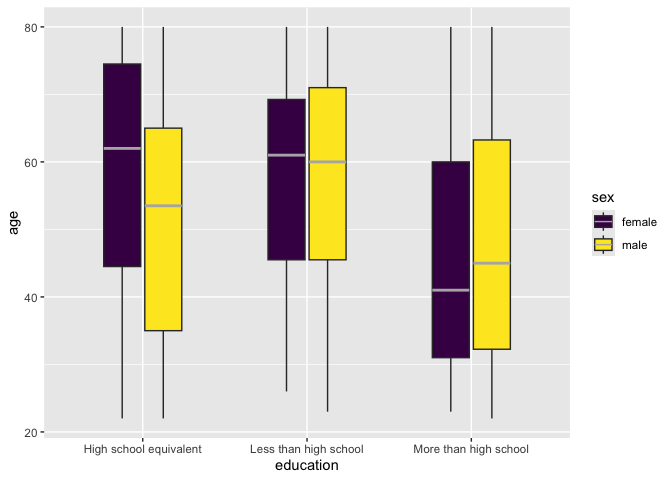
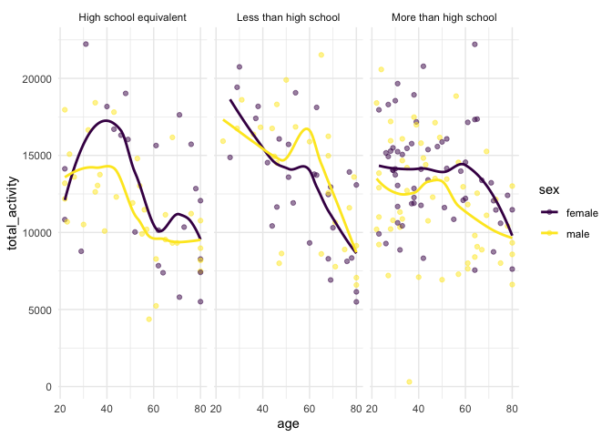
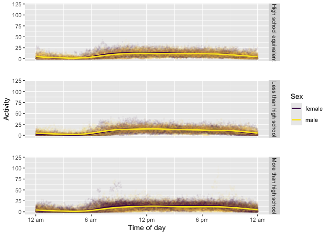
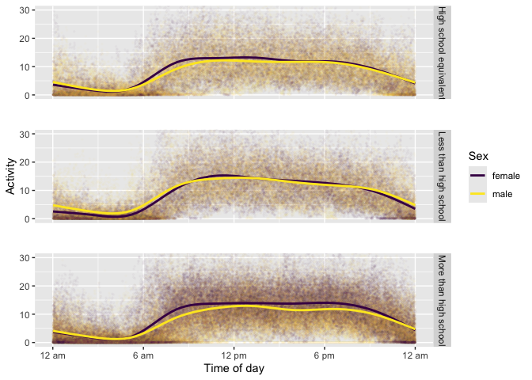

p8105_hw3_hl3464
================
Hongtong Lin
2026-10-12

## Problem 2

load demographic data

``` r
demo_df <- read_csv(
  "nhanes_covar.csv", 
  na = "NA",
  skip = 4
) |> 
  na.omit() |> 
  janitor::clean_names() |> 
  mutate(
    sex=recode_values(sex,
           1~"male",
           2~"female"),
    education = recode_values(
      education,
      1 ~ "Less than high school",
      2 ~ "High school equivalent",
      3 ~ "More than high school"
      
    )
  ) |> 
  filter(age>21)
```

load accelerometers data

``` r
accel_df <- read_csv("nhanes_accel.csv") |> 
  janitor::clean_names() |> 
  na.omit()
```

### reader-friendly table

``` r
demo_tb <- demo_df |> 
  group_by(education, sex) |> 
  summarize(total = n()) |> 
  pivot_wider(names_from = sex, values_from = total)

demo_tb
```

    ## # A tibble: 3 × 3
    ## # Groups:   education [3]
    ##   education              female  male
    ##   <chr>                   <int> <int>
    ## 1 High school equivalent     23    34
    ## 2 Less than high school      28    27
    ## 3 More than high school      59    54

- There are slightly more males than females who have a high school
  equivalent education level.
- The numbers of both sexes that have a less than high school education
  level are about the same.
- Slightly more females than males have a more than high school
  education level.

### plot out age distribution for each category of education

``` r
plt_education <- demo_df |> 
  ggplot(aes(x = education, y = age, fill = sex)) + 
  geom_boxplot(median.color = "grey70", width = 0.5)

plt_education
```

<!-- -->

- Those who have a high school equivalent education level has a slightly
  higher median age, especially in females.
- Those who have a more than high school education level has a smaller
  median age, around 45 years old.

### mutating the movement data

``` r
mvmt_df <- inner_join(demo_df, accel_df, by = "seqn") |> #join two tables together
  mutate(
    total_activity = rowSums(across(min1:min1440))
  ) 

mvmt_df |> 
  ggplot(aes(x = age, y = total_activity, color = sex)) + 
  geom_point(alpha = 0.5)+
  geom_smooth(se = FALSE) +
  facet_grid(cols = vars(education))+
  theme_minimal()
```

<!-- -->

- Older people have fewer activity bouts compared to younger people.
- Those young people (younger than 40 years old) have higher activity
  bouts compared to those from education levels.

### 24-hr activity plots

``` r
mvmt_long <- mvmt_df |> 
  select(seqn, sex, age, education, min1:min1440) |> 
  pivot_longer(
    min1:min1440,
    names_to = "minute",
    names_prefix = "min",
    values_to = "activity"
  ) |> 
  mutate(minute = as.numeric(minute))

mvmt_plt <- mvmt_long |> 
    ggplot(aes(x = minute, y = activity, color = sex)) +
    geom_point(alpha = 0.02, size = 0.5) +
    geom_smooth(se=FALSE)+
    facet_grid(education ~.)+
    scale_x_continuous(
      breaks = seq(0, 1440, 360), # increment step is 360
      labels = c("12 am", "6 am", "12 pm", "6 pm", "12 am")
      ) + 
    scale_y_continuous(limits = c(0, 120)) + 
    labs(
      x = "Time of day",
      y = "Activity",
      color = "Sex"
    ) + 
    theme(panel.spacing.y = unit(2, "lines"))

mvmt_plt
```

<!-- -->

zoom in to check the trend line more clearly

``` r
mvmt_plt + coord_cartesian(ylim = c(0, 30))
```

<!-- -->

- Activity bouts gradually increase from 6 am to 12 pm, plateau at 12
  pm, remain constant and high from 12 to 6pm, and gradually decrease
  from 6pm to 12am.
- On average, across all education levels and across both sexes,
  activity bouts are around 2 bouts at low and around 15 bouts at high.
- Some people with a more than high school education level are pretty
  active (activity around 60) from 6am to around 9 or 10am.
