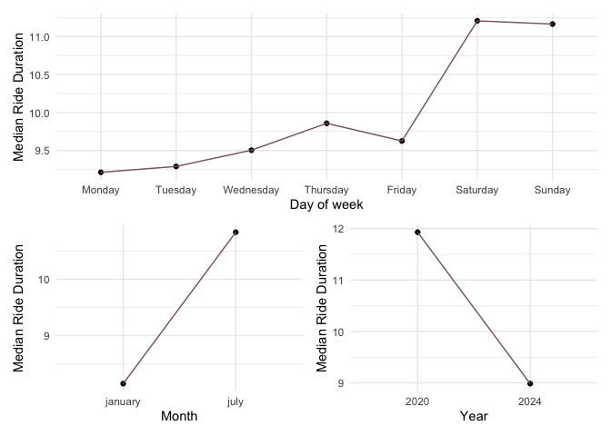
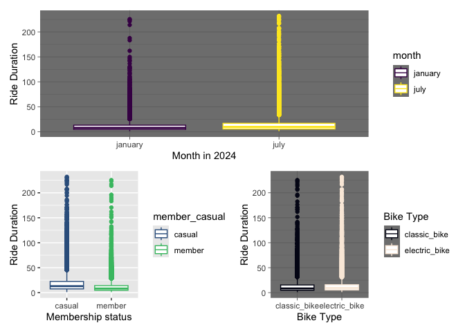
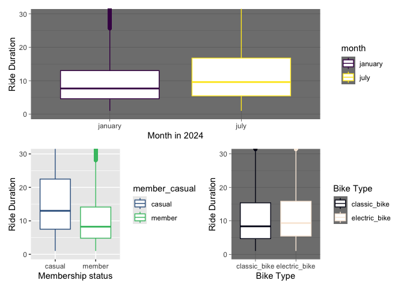

p8105_hw3_hl3464
================
Hongtong Lin
2026-10-12

## Problem 2

load demographic data

``` r
demo_df <- read_csv(
  "nhanes_covar.csv", 
  na = "NA",
  skip = 4
) |> 
  na.omit() |> 
  janitor::clean_names() |> 
  mutate(
    sex=recode_values(sex,
           1~"male",
           2~"female"),
    education = recode_values(
      education,
      1 ~ "Less than high school",
      2 ~ "High school equivalent",
      3 ~ "More than high school"
      
    )
  ) |> 
  filter(age>21)
```

load accelerometers data

``` r
accel_df <- read_csv("nhanes_accel.csv") |> 
  janitor::clean_names() |> 
  na.omit()
```

### reader-friendly table

``` r
demo_tb <- demo_df |> 
  group_by(education, sex) |> 
  summarize(total = n()) |> 
  pivot_wider(names_from = sex, values_from = total)

demo_tb
```

    ## # A tibble: 3 × 3
    ## # Groups:   education [3]
    ##   education              female  male
    ##   <chr>                   <int> <int>
    ## 1 High school equivalent     23    34
    ## 2 Less than high school      28    27
    ## 3 More than high school      59    54

- There are slightly more males than females who have a high school
  equivalent education level.
- The numbers of both sexes that have a less than high school education
  level are about the same.
- Slightly more females than males have a more than high school
  education level.

### plot out age distribution for each category of education

``` r
plt_education <- demo_df |> 
  ggplot(aes(x = education, y = age, fill = sex)) + 
  geom_boxplot(median.color = "grey70", width = 0.5)

plt_education
```

<!-- -->

- Those who have a high school equivalent education level has a slightly
  higher median age, especially in females.
- Those who have a more than high school education level has a smaller
  median age, around 45 years old.

### mutating the movement data

``` r
mvmt_df <- inner_join(demo_df, accel_df, by = "seqn") |> #join two tables together
  mutate(
    total_activity = rowSums(across(min1:min1440))
  ) 

mvmt_df |> 
  ggplot(aes(x = age, y = total_activity, color = sex)) + 
  geom_point(alpha = 0.5)+
  geom_smooth(se = FALSE) +
  facet_grid(cols = vars(education))+
  theme_dark()
```

<!-- -->

- Older people have fewer activity bouts compared to younger people.
- Those young people (younger than 40 years old) have higher activity
  bouts compared to those from education levels.

### 24-hr activity plots

``` r
mvmt_long <- mvmt_df |> 
  select(seqn, sex, age, education, min1:min1440) |> 
  pivot_longer(
    min1:min1440,
    names_to = "minute",
    names_prefix = "min",
    values_to = "activity"
  ) |> 
  mutate(minute = as.numeric(minute))

mvmt_plt <- mvmt_long |> 
    ggplot(aes(x = minute, y = activity, color = sex)) +
    geom_point(alpha = 0.02, size = 0.5) +
    geom_smooth(se=FALSE)+
    facet_grid(education ~.)+
    scale_x_continuous(
      breaks = seq(0, 1440, 360), # increment step is 360
      labels = c("12 am", "6 am", "12 pm", "6 pm", "12 am")
      ) + 
    scale_y_continuous(limits = c(0, 120)) + 
    labs(
      x = "Time of day",
      y = "Activity",
      color = "Sex"
    ) + 
    theme(panel.spacing.y = unit(2, "lines"))

mvmt_plt
```

<!-- -->

zoom in to check the trend line more clearly

``` r
mvmt_plt + coord_cartesian(ylim = c(0, 30))
```

<!-- -->

- Activity bouts gradually increase from 6 am to 12 pm, plateau at 12
  pm, remain constant and high from 12 to 6pm, and gradually decrease
  from 6pm to 12am.
- On average, across all education levels and across both sexes,
  activity bouts are around 2 bouts at low and around 15 bouts at high.
- Some people with a more than high school education level are pretty
  active (activity around 60) from 6am to around 9 or 10am.

## Problem 3

``` r
jan_20_df <- read_csv("citibike/Jan 2020 Citi.csv") |> 
  janitor::clean_names() |> 
  mutate(
    year = 2020,
    month = 'january'
  ) |> 
  relocate(year, month)

jan_24_df <- read_csv("citibike/Jan 2024 Citi.csv")|> 
  janitor::clean_names()|> 
  mutate(
    year = 2024,
    month = 'january'
  ) |> 
  relocate(year, month)

jul_20_df <- read_csv("citibike/July 2020 Citi.csv") |> 
  janitor::clean_names()|> 
  mutate(
    year = 2020,
    month = 'july'
  ) |> 
  relocate(year, month)

jul_24_df <- read_csv("citibike/July 2024 Citi.csv") |> 
  janitor::clean_names()|> 
  mutate(
    year = 2024,
    month = 'july'
  ) |> 
  relocate(year, month)

citi_bike_df <-rbind(jan_20_df, jan_24_df, jul_20_df, jul_24_df)
```

- The merged citi bike data set has 9 variables including year, month,
  ride_id, rideable_type, weekdays, duration, start_station_name,
  end_station_name, and member_casual.
- The merged citi bike data set has 99485 observations.

the total number of rides in each combination of year and month
separating casual riders and Citi Bike members

``` r
citi_bike_df |> 
  group_by(year,month, member_casual) |> 
  count(member_casual) |> 
  pivot_wider(
    names_from = member_casual,
    values_from = n
  )
```

    ## # A tibble: 4 × 4
    ## # Groups:   year, month [4]
    ##    year month   casual member
    ##   <dbl> <chr>    <int>  <int>
    ## 1  2020 january    984  11436
    ## 2  2020 july      5637  15411
    ## 3  2024 january   2108  16753
    ## 4  2024 july     10894  36262

- In January 2020, there were 984 casual riders and 11436 members.
- in July 2929, there were 5637 casual riders and 15411 members.
- In January 2024, there were 2108 casual riders and 16753 members.
- In July 2024, there were 10894 casual riders and 36262 members.
- There was an increasing number of people using citi bikes collected by
  this data set.

most popular starting station for 07/24

``` r
citi_bike_df |> 
  filter(year == 2024, month == "july") |> 
  count(start_station_name,
        name = "number_of_rides_from_start_station",
        sort = TRUE) |> 
  slice_head(n=5)
```

    ## # A tibble: 5 × 2
    ##   start_station_name       number_of_rides_from_start_station
    ##   <chr>                                                 <int>
    ## 1 Pier 61 at Chelsea Piers                                163
    ## 2 University Pl & E 14 St                                 155
    ## 3 W 21 St & 6 Ave                                         152
    ## 4 West St & Chambers St                                   150
    ## 5 W 31 St & 7 Ave                                         146

plotting

``` r
plt_weekdays <-
  citi_bike_df |> 
  mutate(weekdays = factor(weekdays, levels = c("Monday", "Tuesday", "Wednesday",
                                                "Thursday", "Friday", "Saturday", "Sunday"))) |> 
  group_by(weekdays) |> 
  summarize(median_duration = median(duration, na.rm = TRUE)) |> 
  ggplot(aes(x = weekdays, y = median_duration, group = 1)) +
  geom_point() + 
  geom_line(color = "pink4") + 
  labs(
    x = "Day of week",
    y = "Median Ride Duration"
  ) +
  theme_minimal()

plt_year <-
  citi_bike_df |> 
  mutate(year = factor(year, levels = c(2020, 2024))) |> 
  group_by(year) |> 
  summarize(median_duration = median(duration, na.rm = TRUE)) |> 
  ggplot(aes(x = year, y = median_duration, group = 1)) +
  geom_point() + 
  geom_line(color = "pink4") + 
  labs(
    x = "Year",
    y = "Median Ride Duration"
  ) +
  theme_minimal()

plt_month <- 
  citi_bike_df |> 
  group_by(month) |> 
  summarize(median_duration = median(duration, na.rm = TRUE)) |> 
  ggplot(aes(x = month, y = median_duration, group = 1)) +
  geom_point() + 
  geom_line(color = "pink4") + 
  labs(
    x = "Month",
    y = "Median Ride Duration"
  ) +
  theme_minimal()

plt_weekdays/(plt_month | plt_year)
```

<!-- -->

- A very obvious increase in the median ride duration on the weekends
  compared to the weekdays.

- Median ride duration also increased in July compared to January and
  decreased in 2024 compared to 2020.

2024 data

``` r
plt_month_24 <-
  citi_bike_df |> 
    filter(year == 2024) |> 
    group_by(month) |> 
    ggplot(aes(x = month, y = duration, color = month)) + 
    geom_boxplot() + 
    labs(
      x = "Month in 2024",
      y = "Ride Duration"
    ) + 
  theme_dark()

plt_membership_24 <- 
  citi_bike_df |> 
  filter(year == 2024) |> 
  group_by(member_casual) |> 
  ggplot(aes(x = member_casual, y = duration, color = member_casual)) + 
  geom_boxplot() + 
  scale_color_viridis_d(begin = 0.3, end = 0.7) +
  labs(
    x = "Membership status",
    y = "Ride Duration"
  )

plt_bike_type <-
  citi_bike_df |> 
  filter(year == 2024) |> 
  group_by(rideable_type) |> 
  ggplot(aes(x = rideable_type, y = duration, color = rideable_type)) + 
  geom_boxplot() + 
  scale_color_viridis_d(option = "rocket") +
  labs(
    x = "Bike Type",
    y = "Ride Duration",
    color = "Bike Type"
  ) + 
  theme_dark()

plt_month_24/(plt_membership_24 | plt_bike_type)
```

<!-- -->

zoom in to y in (0,30)

``` r
(plt_month_24 / (plt_membership_24 | plt_bike_type)) &
  coord_cartesian(ylim = c(0, 30))
```

<!-- -->

- the duration distribution of all kinds of comparisons are pretty
  spread out.
- interestingly, across all comparisons, median ride duration was around
  8 to 15.
- still, in 2024, ride duration increased in july compared to januray;
  casual riders had a higher ride duration compared to citi bike
  members; and electric bike users had a slightly higher ride duration
  compared to classic bike users.
